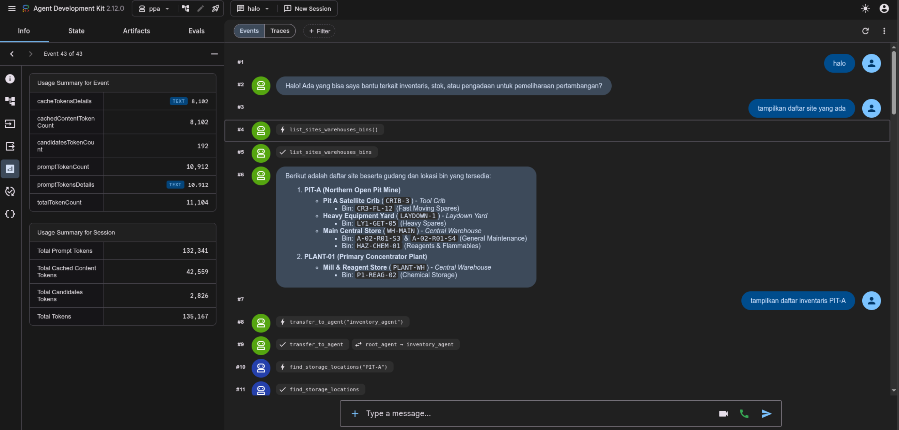
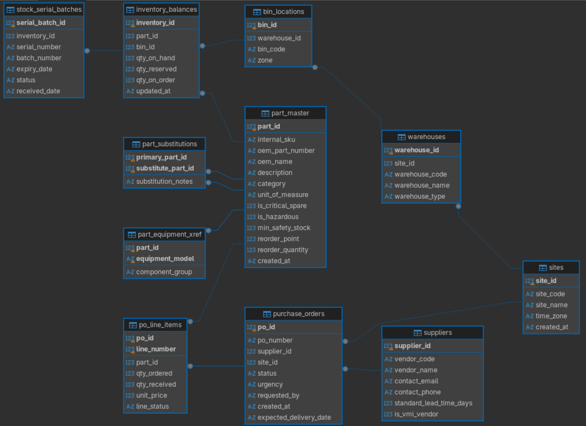

# Take Home Test PPA

An AI assistant for mining maintenance inventory and procurement workflows, built with Google ADK.

## How to Run

### Prerequisites

- Python 3.13 or newer
- [uv](https://docs.astral.sh/uv/getting-started/installation/)
- A Google AI API key with access to the Gemini API

### Setup and start

1. Clone the repository and move into its root directory (the directory containing `pyproject.toml`):

   ```bash
   git clone https://github.com/fahminlb33/take-home-test-ppa.git
   cd take-home-test-ppa
   ```

2. Install the project and its dependencies:

   ```bash
   uv sync
   ```

3. Create the local environment file from the example:

   ```bash
   cp ppa/.env.example ppa/.env
   ```

   Set `GOOGLE_API_KEY` in `ppa/.env` to your Google AI API key.

4. From the repository root, start the ADK web interface:

   ```bash
   uv run adk web --port 8000
   ```

5. Open [http://localhost:8000](http://localhost:8000) and select `ppa` as the agent if prompted.

On startup, SQLAlchemy creates missing tables in the local `database.db`, and `data/seed.sql` is loaded only when both the site and part tables are empty. Existing databases are not migrated; back up and recreate a database whose schema is incompatible with the current models.

## Capabilities

- **Catalog and locations:** Search parts by SKU, OEM part number, description, category, or component group; view recorded interchangeability references and notes; map parts to equipment models and component groups; browse sites, warehouses, and bin locations.
- **Stock:** Check on-hand, reserved, on-order, and calculated available quantities; search serial/batch records and their expiry/status; view and update minimum safety stock, reorder point, and reorder quantity.
- **Procurement:** List and look up vendors; track purchase orders, line items, expected delivery dates, and incoming shipments; create purchase orders, update their status, and record goods receipts.

The available quantity is calculated as on-hand minus reserved. The reduced schema does not support reservations, stock issue/return transactions, transfers, purchase requisitions, shipment manifests or methods, batch quantities, asset-specific equipment mappings, substitution approval status, or SDS/handling instructions.

## Prompts

- Cari suku cadang di katalog berdasarkan SKU, nomor OEM, atau deskripsi.
- Suku cadang apa saja yang dipetakan ke model peralatan atau kelompok komponen tertentu?
- Temukan lokasi gudang dan bin untuk suatu lokasi.
- Periksa stok tersedia, dipesan, dalam pemesanan, dan jumlah di tangan untuk suatu suku cadang.
- Apa pengaturan pemesanan ulang untuk suatu suku cadang? Perbarui titik pemesanan ulang dan jumlahnya.
- Tampilkan pesanan pembelian yang masih menunggu pengiriman beserta perkiraan tanggal tibanya.
- Tampilkan daftar pemasok yang tersedia atau cari detail pemasok.
- Buat pesanan pembelian untuk pemasok dan catat penerimaan barang.

## Documentation

This project relies on Google Agent Development Kit (ADK) and uses Gemini model family. You can change the model from Gemini to any other provider by following the ADK documentation. Also, this project demonstrates how to build agentic chat with sub-agents and tool calling with database query capability through SQLAlchemy.

However, I do not implement the memory savings strategy, as it is easily implemented using [ADK context engineering](https://adk.dev/context/compaction/) and it is meant for deploying ADK agent using Runners, not the ADK web debugger. Nevertheless, the use of sub-agent in this project is also a way to reduce token usage. So, the benefit is still there.

For the model selection, this project defaults to "gemini-3.5-flash-lite" (defined in `agent.py`). However, you can use lightweight models such as Gemma 4 or Qwen3.6 without degradation in chatbot capability and performance.

### ADK web interface



### Relationship diagram



## License

This project is licensed under the [MIT License](LICENSE).

## Ethical AI Usage Disclosure

Generative AI was used to draft the initial project requirements and business process and to assist with implementation of the part catalog, equipment/storage lookups, and reorder tools.
